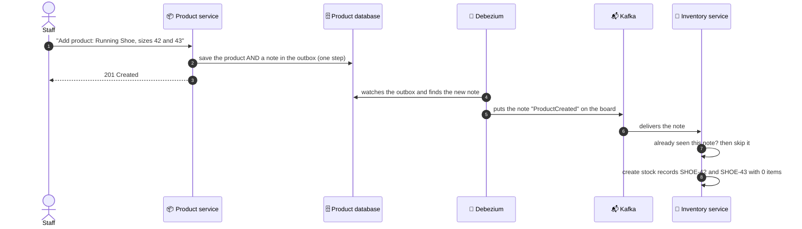
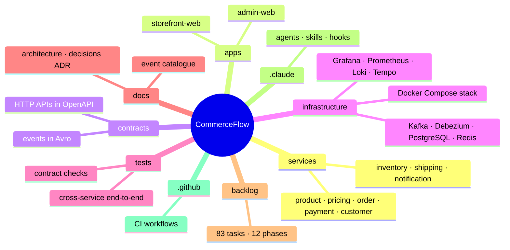
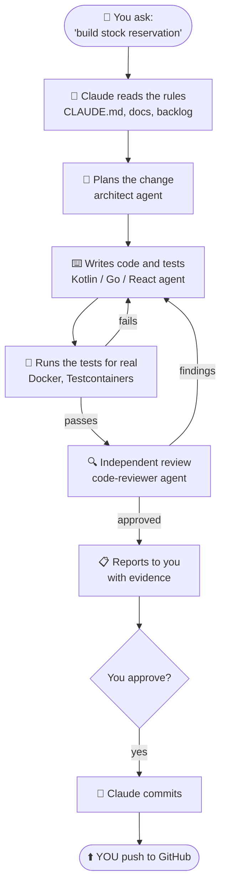
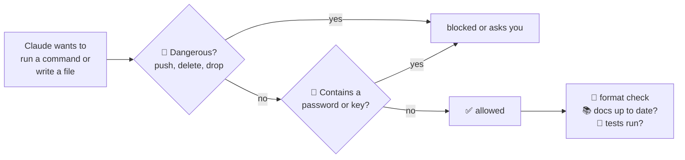
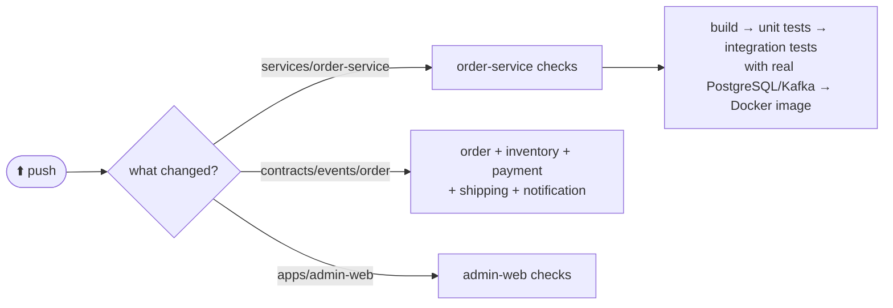

# CommerceFlow

> 🇹🇷 Türkçe: [README.tr.md](README.tr.md)

CommerceFlow is an **online shop platform under construction**, built the way large
companies build theirs: many small programs (*microservices*) that talk to each other
through messages. It is also a **workshop for building software together with Claude**,
an AI assistant that writes, tests and reviews the code inside this repository under
strict safety rules.

This page explains everything in plain words. No prior knowledge needed.

---

## 1. The idea in one picture

Think of a shop with departments. Each department has its own desk, its own filing
cabinet, and they pass notes to each other instead of walking into each other's offices.

```mermaid
flowchart LR
    customer(["🧑 Customer"]) --> storefront["🛍️ Shop website"]
    staff(["👩‍💼 Staff"]) --> admin["🛠️ Admin website"]

    storefront --> services
    admin --> services

    subgraph services["The departments (microservices)"]
        product["📦 Product<br/>what we sell"]
        pricing["💲 Pricing<br/>how much it costs"]
        inventory["🏬 Inventory<br/>how many we have"]
        order["🧾 Order<br/>who bought what"]
        payment["💳 Payment<br/>taking the money"]
        shipping["🚚 Shipping<br/>sending the box"]
        customerSvc["👤 Customer<br/>who our buyers are"]
        notification["✉️ Notification<br/>telling people"]
    end

    services <--> kafka[["📬 Kafka<br/>the message board"]]
```



| Plain words | Technical term |
|---|---|
| a department | a **microservice** (a small program with one job) |
| its filing cabinet | its own **PostgreSQL database**; nobody else may open it |
| the notes they pass | **events** such as "ProductCreated", sent through **Kafka** |
| the rules for what a note looks like | **contracts** (Avro schemas and OpenAPI files in `contracts/`) |

Why so many pieces? So that one department can change, grow or crash **without
taking the whole shop down**, and so that each one can be updated on its own.

---

## 2. What works today (and what does not yet)

Honest status, checked on 2026-11-12. ✅ = built **and** tested. ⬜ = planned.

```mermaid
flowchart LR
    a["✅ Repository structure<br/>and documentation"] --> b["✅ All 10 programs build<br/>and have health checks"]
    b --> c["✅ Local infrastructure<br/>runs in Docker"]
    c --> d["✅ First real feature<br/>product → inventory"]
    d --> e["✅ CI on GitHub<br/>per program"]
    e --> f["⬜ Orders, payment,<br/>shipping (saga)"]
    f --> g["⬜ Shop and admin<br/>websites with real pages"]
    g --> h["⬜ Production:<br/>Kubernetes, security, alerts"]
```



| Area | Status |
|---|---|
| 8 backend services + 2 websites exist, build, start and answer health checks | ✅ |
| Local infrastructure (database, Kafka, monitoring…) starts with one command | ✅ |
| **Create a product → inventory gets a stock record automatically** | ✅ tested end to end |
| Every program has its own automatic check on GitHub (CI) | ✅ |
| Orders, payments, shipping, e-mails | ⬜ planned |
| Real pages in the shop and admin websites | ⬜ planned (today they show a placeholder) |
| Login, security scanning, Kubernetes, production deployment | ⬜ planned |

The full to-do list is in [`backlog/`](backlog/BACKLOG.md): 83 tasks in 12 phases.

---

## 3. The first feature, step by step

What happens when staff add a new product (this works today):



Why this way?

- **Outbox** – the product and the note are saved together, so a note is never lost
  and never sent for a product that was not saved.
- **Debezium** – a robot that reads new notes from the database and posts them to Kafka.
- **Inbox** – the inventory service remembers every note it handled, so if a note
  arrives twice, nothing happens twice.
- **Dead-letter topic** – a broken note goes to a separate box for humans to look at,
  instead of blocking everything.

---

## 4. What is in this repository



| Folder | In plain words |
|---|---|
| `services/` | the 8 departments. Kotlin: product, pricing, order, payment, customer. Go: inventory, shipping, notification |
| `apps/` | the 2 websites (React + TypeScript) |
| `contracts/` | the agreed shape of every message and every web API; the **only** thing services share |
| `infrastructure/` | everything that runs around the services: database, Kafka, monitoring |
| `tests/` | tests that need more than one service at once |
| `docs/` | how and why it is designed this way |
| `backlog/` | the to-do list |
| `.claude/` | how Claude is set up to work here safely |
| `.github/workflows/` | the automatic checks that run on GitHub |

**The golden rule:** a service never reaches into another service's code or database.
They only talk through messages (Kafka) or published web APIs.

---

## 5. What Claude does in this repository

Claude is an AI coding assistant. Here it works like a small engineering team that
follows a rulebook.



### The team (agents)

| Agent | Job |
|---|---|
| `commerce-architect` | designs, plans changes that touch several services |
| `kotlin-backend-engineer` | builds Kotlin services |
| `golang-backend-engineer` | builds Go services |
| `frontend-engineer` | builds the websites |
| `event-driven-engineer` | Kafka, Debezium, message design |
| `database-engineer` | tables, indexes, safe migrations |
| `devops-engineer` | Docker, CI, Kubernetes |
| `test-engineer` | tests across services |
| `code-reviewer` | reviews code, cannot change it |
| `security-reviewer` | looks for security problems, cannot change code |

### The know-how (skills)

43 written playbooks in `.claude/skills/`, for example *how to write a safe database
migration* or *how to make a consumer idempotent*. 12 of them are workflows you can call
by name: `/implement-feature`, `/write-tests`, `/code-review`, `/security-audit`,
`/debug-event-flow`, `/prepare-pull-request` and more (list:
[`docs/workflow-catalog.md`](docs/workflow-catalog.md)).

### The safety belts (hooks)

Small scripts that run automatically around every action Claude takes:



### What Claude will NOT do

| Never without you | Why |
|---|---|
| push to GitHub, merge, deploy | you stay in control of what goes public |
| delete data, run destructive migrations | can't be undone |
| type passwords or tokens | you log in yourself |
| say "it works" without running it | every claim comes with test output |

---

## 6. What you can do with it

### See the first feature working on your computer

Needs Docker Desktop. From the repository folder (Windows PowerShell):

```bash
powershell -File infrastructure/scripts/up.ps1
```

```bash
powershell -File infrastructure/scripts/migrate.ps1 -All
```

```bash
powershell -File infrastructure/scripts/register-schemas.ps1
```

```bash
powershell -File infrastructure/scripts/register-connectors.ps1
```

```bash
docker compose --profile apps up -d --build product-service inventory-service
```

```bash
powershell -File tests/integration/run-e2e.ps1
```

The last command creates a product and checks that it reached the inventory service.
Then look around:

| Open | To see |
|---|---|
| http://localhost:3000 | Grafana: dashboards, logs, traces |
| http://localhost:8095 | Kafka UI: the messages on the board |
| http://localhost:9090 | Prometheus: raw metrics |

Stop everything (data is kept):

```bash
powershell -File infrastructure/scripts/down.ps1
```

### Build or test one program

```bash
powershell -File scripts/test-service.ps1 product-service -Integration
```

All commands per program: [`docs/service-catalog.md`](docs/service-catalog.md).

### Ask Claude for the next piece

Examples of requests that fit the backlog:

- "Implement CF-048: stock reservation in inventory-service"
- "Write the remaining event schemas (CF-002)"
- "Review my last commit for security problems"
- "Why didn't this event reach the inventory service?"

---

## 7. Automatic checks on GitHub (CI)

Every push runs **only the checks for the parts that changed**:



Workflows live in [`.github/workflows/`](.github/workflows/). Images are built but not
published yet (no image registry chosen).

---

## 8. Technology, in one line each

| Tool | What it is used for |
|---|---|
| Kotlin + Spring Boot | 5 services (product, pricing, order, payment, customer) |
| Go | 3 services (inventory, shipping, notification) |
| React + TypeScript | the 2 websites |
| PostgreSQL | one database per service |
| Kafka | the message board between services |
| Debezium | copies new outbox notes from the database to Kafka |
| Schema Registry + Avro | checks that every message has the agreed shape |
| Redis | fast cache (planned use) |
| OpenTelemetry, Tempo, Loki, Prometheus, Grafana | follow a request across services, logs, metrics, dashboards |
| Docker / Docker Compose | runs everything locally |
| Testcontainers | tests start real databases and Kafka in Docker |
| GitHub Actions | automatic checks on every push |
| Kubernetes, Helm, Terraform | production deployment (planned) |

---

## 9. Read more

| If you want to know… | Read |
|---|---|
| the big picture of the design | [`docs/architecture/overview.md`](docs/architecture/overview.md) |
| why it is one repository with many services | [`docs/adr/0004-modular-monorepo.md`](docs/adr/0004-modular-monorepo.md) |
| every message and who sends/receives it | [`docs/event-catalog/README.md`](docs/event-catalog/README.md) |
| how to run the infrastructure | [`infrastructure/README.md`](infrastructure/README.md) |
| what is left to build | [`backlog/BACKLOG.md`](backlog/BACKLOG.md) |
| how healthy the framework is | [`docs/framework-audit-report.md`](docs/framework-audit-report.md) |
| the rules Claude follows | [`CLAUDE.md`](CLAUDE.md) |

---

Repository: https://github.com/bestekucuk/CommerceFlow. Claude commits locally; the
owner reviews and pushes.
