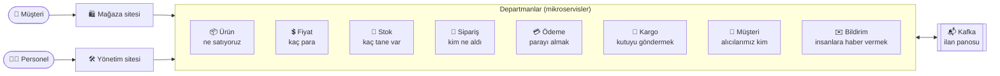
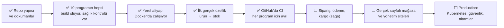
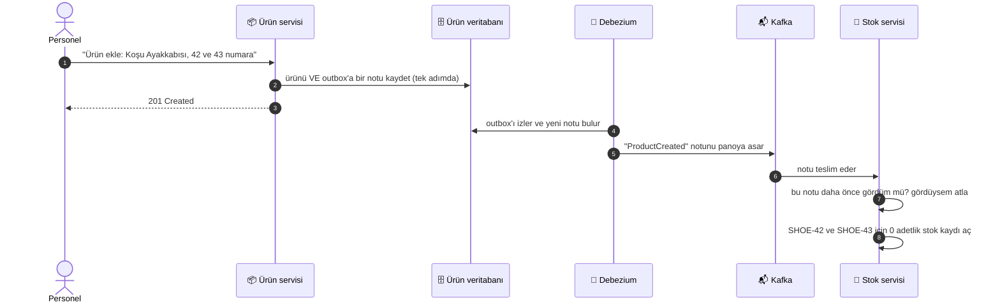
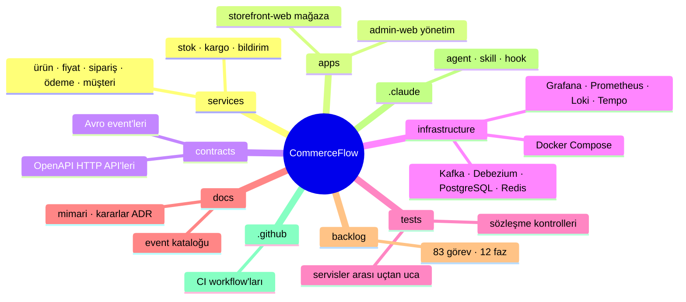
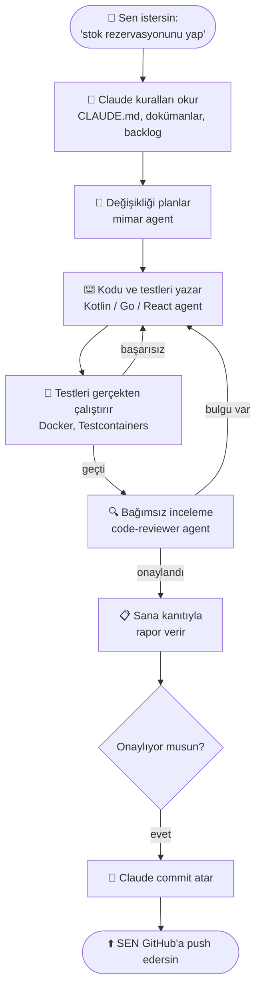
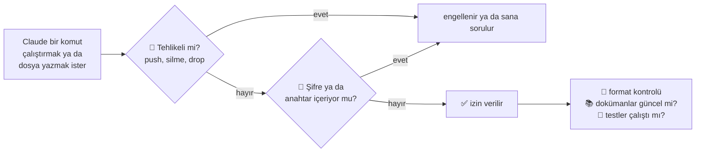
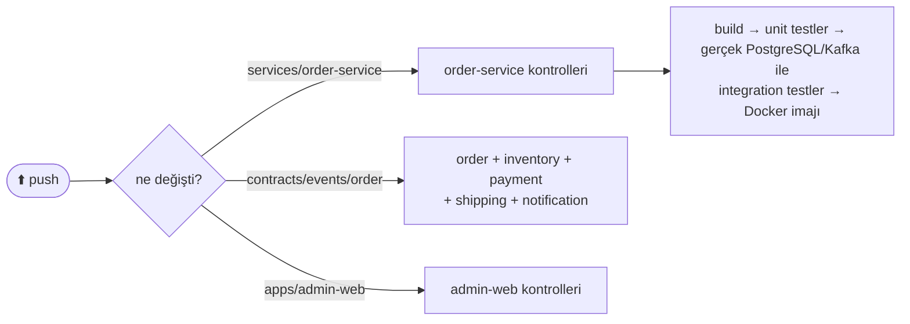

# CommerceFlow

> 🇬🇧 English: [README.md](README.md)

CommerceFlow, **yapım aşamasındaki bir online mağaza platformu**. Büyük şirketlerin
mağazalarını kurduğu yöntemle kuruluyor: birbirine mesaj gönderen birçok küçük program
(*mikroservis*). Aynı zamanda **Claude ile birlikte yazılım geliştirme atölyesi**: Claude,
bu repo içinde sıkı güvenlik kurallarıyla kod yazan, test eden ve inceleyen bir yapay zekâ
asistanı.

Bu sayfa her şeyi sade bir dille anlatıyor. Ön bilgi gerekmez.

---

## 1. Tek resimde fikir

Departmanları olan bir mağaza düşün. Her departmanın kendi masası ve kendi dosya dolabı
var. Birbirlerinin odasına girmek yerine birbirlerine **not** bırakıyorlar.



| Sade dille | Teknik adı |
|---|---|
| bir departman | bir **mikroservis** (tek işi olan küçük program) |
| onun dosya dolabı | kendi **PostgreSQL veritabanı**; başkası açamaz |
| birbirine bıraktıkları notlar | **event**'ler, örneğin "ProductCreated"; **Kafka** üzerinden gider |
| notun nasıl görüneceğinin kuralı | **sözleşmeler** (`contracts/` içindeki Avro ve OpenAPI dosyaları) |

Neden bu kadar parça? Bir departman **bütün mağazayı çökertmeden** değişebilsin, büyüyebilsin
ya da çökebilsin; her biri tek başına güncellenebilsin diye.

---

## 2. Bugün ne çalışıyor (ve ne henüz çalışmıyor)

Dürüst durum, 2026-11-12 itibarıyla. ✅ = yapıldı **ve** test edildi. ⬜ = planlandı.



| Alan | Durum |
|---|---|
| 8 backend servisi + 2 web sitesi var; build oluyor, açılıyor, sağlık kontrolüne cevap veriyor | ✅ |
| Yerel altyapı (veritabanı, Kafka, izleme…) tek komutla açılıyor | ✅ |
| **Ürün oluştur → stok servisi otomatik stok kaydı açar** | ✅ uçtan uca test edildi |
| Her programın GitHub'da kendi otomatik kontrolü (CI) var | ✅ |
| Sipariş, ödeme, kargo, e-posta | ⬜ planlandı |
| Mağaza ve yönetim sitelerinde gerçek sayfalar | ⬜ planlandı (şimdilik boş sayfa) |
| Giriş sistemi, güvenlik taramaları, Kubernetes, canlıya çıkış | ⬜ planlandı |

Yapılacakların tam listesi [`backlog/`](backlog/BACKLOG.md) klasöründe: 12 fazda 83 görev.

---

## 3. İlk özellik, adım adım

Personel yeni bir ürün eklediğinde ne olur (bugün çalışıyor):



Neden böyle?

- **Outbox:** Ürün ve not birlikte kaydedilir. Böylece not asla kaybolmaz ve kaydedilmemiş
  bir ürün için asla not gönderilmez.
- **Debezium:** Veritabanındaki yeni notları okuyup Kafka'ya asan bir robot.
- **Inbox:** Stok servisi işlediği her notu hatırlar. Aynı not iki kez gelirse hiçbir şey
  iki kez olmaz.
- **Dead-letter topic:** Bozuk bir not her şeyi tıkamak yerine, insanların bakması için
  ayrı bir kutuya gider.

---

## 4. Bu repoda neler var



| Klasör | Sade dille |
|---|---|
| `services/` | 8 departman. Kotlin: product, pricing, order, payment, customer. Go: inventory, shipping, notification |
| `apps/` | 2 web sitesi (React + TypeScript) |
| `contracts/` | her mesajın ve her web API'sinin anlaşılmış şekli; servislerin paylaştığı **tek** şey |
| `infrastructure/` | servislerin etrafında çalışan her şey: veritabanı, Kafka, izleme |
| `tests/` | aynı anda birden fazla servis gerektiren testler |
| `docs/` | neyin nasıl ve neden böyle tasarlandığı |
| `backlog/` | yapılacaklar listesi |
| `.claude/` | Claude'un burada güvenli çalışması için ayarlar |
| `.github/workflows/` | GitHub'da otomatik çalışan kontroller |

**Altın kural:** Bir servis asla başka bir servisin koduna veya veritabanına dokunmaz.
Sadece mesajlarla (Kafka) veya yayınlanmış web API'leriyle konuşurlar.

---

## 5. Claude bu repoda ne yapıyor

Claude bir yapay zekâ kodlama asistanı. Burada, bir kural kitabına uyan küçük bir
mühendislik ekibi gibi çalışıyor.



### Ekip (agent'lar)

| Agent | Görevi |
|---|---|
| `commerce-architect` | tasarlar, birden fazla servisi etkileyen değişiklikleri planlar |
| `kotlin-backend-engineer` | Kotlin servislerini yazar |
| `golang-backend-engineer` | Go servislerini yazar |
| `frontend-engineer` | web sitelerini yazar |
| `event-driven-engineer` | Kafka, Debezium, mesaj tasarımı |
| `database-engineer` | tablolar, indeksler, güvenli migration'lar |
| `devops-engineer` | Docker, CI, Kubernetes |
| `test-engineer` | servisler arası testler |
| `code-reviewer` | kodu inceler, değiştiremez |
| `security-reviewer` | güvenlik sorunlarını arar, kodu değiştiremez |

### Bilgi birikimi (skill'ler)

`.claude/skills/` içinde 43 yazılı rehber var. Örneğin *güvenli veritabanı migration'ı
nasıl yazılır* ya da *bir consumer nasıl idempotent yapılır*. Bunların 12'si adıyla
çağırabileceğin iş akışları: `/implement-feature`, `/write-tests`, `/code-review`,
`/security-audit`, `/debug-event-flow`, `/prepare-pull-request` ve diğerleri (liste:
[`docs/workflow-catalog.md`](docs/workflow-catalog.md)).

### Emniyet kemerleri (hook'lar)

Claude'un yaptığı her işlemin etrafında otomatik çalışan küçük script'ler:



### Claude'un YAPMAYACAKLARI

| Sensiz asla | Neden |
|---|---|
| GitHub'a push, merge, deploy | neyin yayınlanacağına sen karar verirsin |
| veri silmek, geri dönüşsüz migration | geri alınamaz |
| şifre ya da token yazmak | girişleri sen yaparsın |
| çalıştırmadan "çalışıyor" demek | her iddia test çıktısıyla gelir |

---

## 6. Bununla neler yapabilirsin

### İlk özelliği kendi bilgisayarında çalışırken gör

Docker Desktop gerekir. Repo klasöründe (Windows PowerShell):

```bash
powershell -File infrastructure/scripts/up.ps1
```

```bash
powershell -File infrastructure/scripts/migrate.ps1 -All
```

```bash
powershell -File infrastructure/scripts/register-schemas.ps1
```

```bash
powershell -File infrastructure/scripts/register-connectors.ps1
```

```bash
docker compose --profile apps up -d --build product-service inventory-service
```

```bash
powershell -File tests/integration/run-e2e.ps1
```

Son komut bir ürün oluşturur ve stok servisine ulaştığını kontrol eder. Sonra etrafa bak:

| Aç | Ne görürsün |
|---|---|
| http://localhost:3000 | Grafana: dashboard'lar, log'lar, trace'ler |
| http://localhost:8095 | Kafka UI: panodaki mesajlar |
| http://localhost:9090 | Prometheus: ham metrikler |

Her şeyi durdur (veriler korunur):

```bash
powershell -File infrastructure/scripts/down.ps1
```

### Tek bir programı build et veya test et

```bash
powershell -File scripts/test-service.ps1 product-service -Integration
```

Her program için bütün komutlar: [`docs/service-catalog.md`](docs/service-catalog.md).

### Claude'dan bir sonraki parçayı iste

Backlog'a uyan istek örnekleri:

- "CF-048'i yap: inventory-service'te stok rezervasyonu"
- "Kalan event şemalarını yaz (CF-002)"
- "Son commit'imi güvenlik açısından incele"
- "Bu event neden stok servisine ulaşmadı?"

---

## 7. GitHub'daki otomatik kontroller (CI)

Her push'ta **sadece değişen parçaların kontrolleri** çalışır:



Workflow'lar [`.github/workflows/`](.github/workflows/) klasöründe. İmajlar build ediliyor
ama henüz bir yere yayınlanmıyor (imaj registry'si seçilmedi).

---

## 8. Teknolojiler, her biri tek satırda

| Araç | Ne için kullanılıyor |
|---|---|
| Kotlin + Spring Boot | 5 servis (product, pricing, order, payment, customer) |
| Go | 3 servis (inventory, shipping, notification) |
| React + TypeScript | 2 web sitesi |
| PostgreSQL | her servise bir veritabanı |
| Kafka | servisler arası ilan panosu |
| Debezium | outbox'taki yeni notları veritabanından Kafka'ya kopyalar |
| Schema Registry + Avro | her mesajın anlaşılan şekle uyduğunu kontrol eder |
| Redis | hızlı önbellek (kullanımı planlandı) |
| OpenTelemetry, Tempo, Loki, Prometheus, Grafana | bir isteği servisler arasında izlemek, log'lar, metrikler, dashboard'lar |
| Docker / Docker Compose | her şeyi yerelde çalıştırır |
| Testcontainers | testler Docker'da gerçek veritabanı ve Kafka açar |
| GitHub Actions | her push'ta otomatik kontroller |
| Kubernetes, Helm, Terraform | canlı ortama deploy (planlandı) |

---

## 9. Daha fazlası

| Bilmek istediğin… | Oku |
|---|---|
| tasarımın büyük resmi | [`docs/architecture/overview.md`](docs/architecture/overview.md) |
| neden tek repoda çok servis | [`docs/adr/0004-modular-monorepo.md`](docs/adr/0004-modular-monorepo.md) |
| her mesaj ve onu kimin gönderip aldığı | [`docs/event-catalog/README.md`](docs/event-catalog/README.md) |
| altyapının nasıl çalıştırıldığı | [`infrastructure/README.md`](infrastructure/README.md) |
| geriye ne kaldığı | [`backlog/BACKLOG.md`](backlog/BACKLOG.md) |
| framework'ün sağlık durumu | [`docs/framework-audit-report.md`](docs/framework-audit-report.md) |
| Claude'un uyduğu kurallar | [`CLAUDE.md`](CLAUDE.md) |

---

Repo: https://github.com/bestekucuk/CommerceFlow. Claude yerelde commit atar; sahibi
inceler ve push eder.
