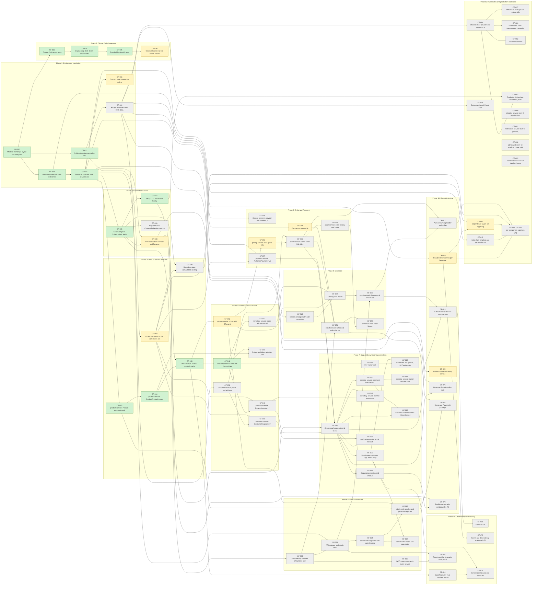

# Dependencies

Status legend: ✅ Done = verified in this repository (evidence given) · 🟡 In progress · ⛔ Blocked · ⬜ Not started.
Generated from one data source; IDs `CF-0xx` keep the numbers already used in `docs/`. Snapshot: 2026-11-12.

Arrows point from a prerequisite to the task that needs it. Colours: green done, yellow in progress, red blocked, grey not started.

## Critical path (longest dependency chain)

[CF-030](TASKS.md#cf-030) → [CF-021](TASKS.md#cf-021) → [CF-032](TASKS.md#cf-032) → [CF-043](TASKS.md#cf-043) → [CF-044](TASKS.md#cf-044) → [CF-045](TASKS.md#cf-045) → [CF-052](TASKS.md#cf-052) → [CF-053](TASKS.md#cf-053) → [CF-055](TASKS.md#cf-055) → [CF-010](TASKS.md#cf-010) → [CF-060](TASKS.md#cf-060) → [CF-062](TASKS.md#cf-062)

## Vertical slice first

The first end-to-end slice proves the architecture before breadth: product created → outbox → Debezium → Kafka → inventory/pricing consume → order → saga confirmed.

[CF-005](TASKS.md#cf-005) → [CF-037](TASKS.md#cf-037) → [CF-002](TASKS.md#cf-002) → [CF-003](TASKS.md#cf-003) → [CF-043](TASKS.md#cf-043) → [CF-044](TASKS.md#cf-044) → [CF-038](TASKS.md#cf-038) → [CF-045](TASKS.md#cf-045) → [CF-046](TASKS.md#cf-046) → [CF-052](TASKS.md#cf-052) → [CF-053](TASKS.md#cf-053) → [CF-055](TASKS.md#cf-055) → [CF-048](TASKS.md#cf-048) → [CF-057](TASKS.md#cf-057) → [CF-010](TASKS.md#cf-010)

## Ready to start now (all dependencies done)

| Task | Title | Priority | Unblocks (transitively) |
|---|---|---|---|
| [CF-052](TASKS.md#cf-052) | pricing-service: prices with ETag and ProductPriceChanged | P0 | 35 tasks |
| [CF-001](TASKS.md#cf-001) | Accept or revise ADRs 0005-0011 | P0 | 32 tasks |
| [CF-002](TASKS.md#cf-002) | v1 Avro schemas for the core event catalogue | P0 | 30 tasks |
| [CF-065](TASKS.md#cf-065) | Local identity provider (Keycloak) and roles | P0 | 23 tasks |
| [CF-003](TASKS.md#cf-003) | Contract code generation tooling | P0 | 0 tasks |
| [CF-050](TASKS.md#cf-050) | customer-service: profile and address API | P1 | 32 tasks |
| [CF-038](TASKS.md#cf-038) | Wire application services and Toxiproxy into Compose | P1 | 15 tasks |
| [CF-047](TASKS.md#cf-047) | inventory-service: stock adjustment API | P1 | 15 tasks |
| [CF-020](TASKS.md#cf-020) | Reusable CI workflows per language | P1 | 12 tasks |
| [CF-019](TASKS.md#cf-019) | Helm chart template and per-service values | P1 | 10 tasks |
| [CF-012](TASKS.md#cf-012) | OpenTelemetry in all services, trace through outbox | P1 | 1 tasks |
| [CF-042](TASKS.md#cf-042) | DLT replay tool | P1 | 1 tasks |
| [CF-022](TASKS.md#cf-022) | Architecture tests in every service | P1 | 0 tasks |
| [CF-094](TASKS.md#cf-094) | Outbox and inbox retention jobs | P1 | 0 tasks |
| [CF-039](TASKS.md#cf-039) | Expose Kafka Connect/Debezium metrics | P2 | 0 tasks |
| [CF-036](TASKS.md#cf-036) | Observe hooks in a live Claude session | P3 | 0 tasks |

## Blocked

## Contract dependencies (monorepo rule)

- Any change in `contracts/events` must pass [CF-040](TASKS.md#cf-040) compatibility checks and trigger the pipelines of every producer and consumer ([CF-080](TASKS.md#cf-080)).
- Provider APIs consumed by apps or services are gated by Pact ([CF-017](TASKS.md#cf-017)) before deployment ([CF-084..CF-093](TASKS.md#phase-12--kubernetes-and-production-readiness)).
- Producer and consumer of one event are separate tasks and deploy separately: consumers first for additive changes (`docs/event-catalog/event-versioning-policy.md`).
