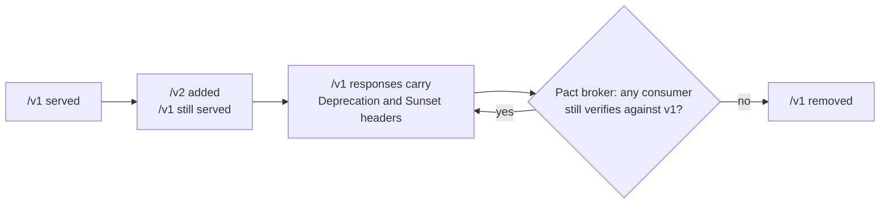

# API versioning

Status: **planned** — policy for the first APIs.

## Scheme

- **Major version in the path**: `/v1/...`. One OpenAPI file per major version
  (`order-service.v1.yaml`, later `order-service.v2.yaml`).
- Minor, backward-compatible changes do not change the path; `info.version` in the spec is
  bumped (`1.1.0`).
- No version headers or media-type versioning (simpler for gateways, caches and Pact).

## Compatible (minor) changes

- New endpoint, new optional request field, new response field, new optional query
  parameter, new enum value **when the spec says clients must tolerate unknown values**,
  new error type with an existing status code.

## Breaking (major) changes

- Removing or renaming fields or endpoints, changing types or meaning, making an optional
  input required, changing status codes or error semantics, tightening validation, changing
  authentication requirements.

## Lifecycle

- Removal is driven by consumers (Pact broker and gateway access logs), not by a fixed
  calendar date. Sunset dates are set per case.
- Both versions are implemented by the same service, mapping to the same use cases.

## Consumers

- Frontends regenerate clients from the spec and must tolerate unknown response fields.
- Service-to-service HTTP consumers (order → pricing, order → customer) are covered by
  Pact like frontends.

## Relation to events

HTTP versions and event versions are independent: an API `/v2` does not imply new event
versions ([../event-catalog/event-versioning-policy.md](../event-catalog/event-versioning-policy.md)).
