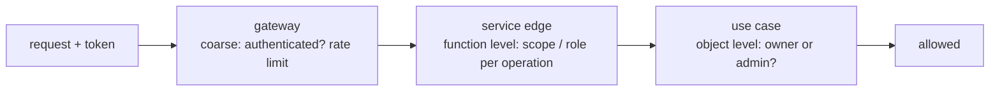

# Authentication and authorization

Status: **planned**. No identity provider, gateway or secured endpoint exists. The OIDC
provider product is **open**; local development is planned with Keycloak in Compose.
Decisions: ADR-0010 (gateway, admin BFF). Skill: `secure-backend-development`.

## Identities

| Principal | Authenticates with | Token |
|---|---|---|
| Customer (storefront) | OIDC Authorization Code + PKCE in the browser | access token in memory, short-lived |
| Staff (admin-web) | OIDC via the admin BFF (token-handler pattern) | session cookie (`HttpOnly`, `Secure`, `SameSite`) to the browser; tokens kept by the BFF |
| Service (sync calls, e.g. order → pricing) | OAuth 2.0 client credentials | access token with the callee's audience |
| Kafka clients | broker authentication (mTLS or SASL — open) | — |

## Token validation (every service, not only the gateway)

- Signature via JWKS; allowed algorithms pinned (e.g. RS256/ES256).
- `iss` = configured issuer, `aud` contains the service name (`order-service`), `exp`/`nbf`
  checked.
- No trust in identity headers set by the gateway or BFF.

## Authorization model

| Level | Rule | Example |
|---|---|---|
| Function | scopes for customers, roles for staff | `orders:write`; `ROLE_PRICING_ADMIN` for `PUT /v1/prices/{sku}` |
| Object | caller owns the resource, or holds the context's admin role | `order.customerId == token.sub` |
| Data | response contains only fields the caller may see | no payment provider data for customers |

Object-level checks live in the application layer, so they apply regardless of the entry
point. Other customers' resources return 404.

## Roles (initial proposal)

| Role | Grants |
|---|---|
| `ROLE_CATALOG_ADMIN` | product-service writes |
| `ROLE_PRICING_ADMIN` | pricing-service writes |
| `ROLE_INVENTORY_ADMIN` | stock adjustments |
| `ROLE_ORDER_ADMIN` | order reads for all customers, cancellations |
| `ROLE_SHIPPING_ADMIN` | shipment management |
| `ROLE_SUPPORT` | read-only access across contexts via the BFF |

The final role model is decided with the identity provider setup.

## Events and authorization

Events are not authorization-bearing: consumers trust events because only Kafka Connect
(outbox path) may write to event and command topics (planned Kafka ACLs). Event payloads
avoid personal data.

## Open points

- Identity provider product and hosting.
- Customer registration flow (IdP-hosted vs. storefront form) and linking to
  customer-service.
- Kafka authentication mechanism.
- Admin session store for the BFF.
