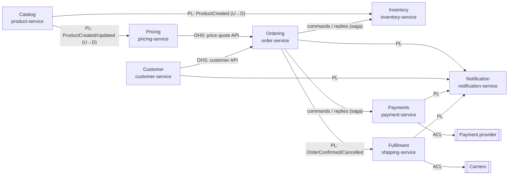

# Bounded context map

Status: **planned** (design). Context boundaries are decided by this document and
ADR-0004/0005; no code exists.

## Map

PL = published language (Avro events in `contracts/events`), OHS = open host service
(OpenAPI in `contracts/openapi`), ACL = anti-corruption layer, U→D = upstream to
downstream.

## Relationships

| Upstream | Downstream | Pattern | What crosses the boundary |
|---|---|---|---|
| Catalog | Pricing, Inventory, catalog read model | Customer/supplier via published language | Product IDs, SKUs, lifecycle facts |
| Pricing | Ordering | Open host service (synchronous quote) | Price quote for SKUs at checkout |
| Pricing | catalog read model | Published language | `ProductPriceChanged` |
| Customer | Ordering | Open host service | Customer existence and default address |
| Customer | Notification | Published language | Contact facts |
| Ordering | Inventory, Payments | Orchestrated saga (commands + reply events) | Reservation and payment requests |
| Ordering | Fulfilment, Notification | Published language | Order lifecycle facts |
| Payments | external provider | Anti-corruption layer | Provider charges mapped to domain results |
| Fulfilment | carriers | Anti-corruption layer | Carrier shipments mapped to domain shipments |

## Ubiquitous language (key terms)

| Term | Context | Meaning |
|---|---|---|
| Product / SKU | Catalog | A sellable item and its stock-keeping unit |
| Price quote | Pricing | Price of a set of SKUs for a customer at a time, with an expiry |
| Reservation | Inventory | Stock held for an order until confirmed, released or expired |
| Order | Ordering | A customer's request to buy lines, with a lifecycle |
| Authorization | Payments | Funds held at the provider, not yet captured |
| Shipment | Fulfilment | Physical delivery of an order's lines |

## Boundary decisions and trade-offs

- **Pricing separate from Catalog**: prices change on a different cadence and with
  promotions; separating them keeps catalog edits from affecting price logic. Cost: the
  storefront needs a read model joining both (CF-015).
- **Inventory separate from Ordering**: stock is contended under load and has its own
  invariants (no oversell). Cost: reservation requires a saga step.
- **Notification as its own context**: delivery concerns (templates, retries, providers)
  stay out of every other service. Cost: notification needs contact data via events.
- **Open**: who owns the cart (CF-014) and the catalog read model (CF-015).
