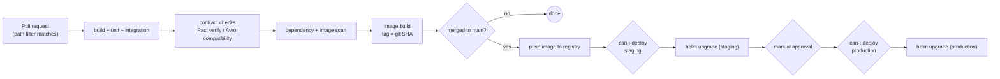

# Build and release strategy

Status: **planned**. No build files, workflows or images exist yet. The repository has no
remote, so no CI can run. Decision: ADR-0011.

## Build per component

| Component type | Build | Tests in the build | Artifact |
|---|---|---|---|
| Kotlin service | `./gradlew build` in `services/<name>/` (own wrapper) | unit, Testcontainers integration, ArchUnit | Spring Boot jar → image |
| Go service | `make lint test build` in `services/<name>/` (own `go.mod`) | unit, `-race`, integration (tagged) | static binary → image |
| Web app | `npm ci && npm run typecheck && npm test && npm run build` in `apps/<name>/` | Vitest, Pact consumer | static assets → image |

Contract code is generated by each build from `contracts/` (Avro codegen, OpenAPI client
generation). Generated code is never committed and never shared.

## Pipeline per component

Path filters: the component folder, the contracts it produces or consumes (from
`docs/event-catalog/README.md`), its OpenAPI spec, and its workflow file.
`scripts/affected-components.ps1` implements the same mapping locally.

## Release rules

1. Images are immutable and promoted (same digest staging → production).
2. A release must be compatible with what runs in the target environment:
   - HTTP: Pact `can-i-deploy`.
   - Events: schema registered and BACKWARD compatible before the producer deploys;
     consumers of a new field deploy first.
   - Database: expand migration released before code that needs it; contract migration
     only after the previous version is gone ([migration-strategy.md](migration-strategy.md)).
3. Rollback = redeploy the previous image. This is safe because migrations are
   expand-only within a release.
4. No release train: services release at their own pace.
5. Claude never pushes, merges, deploys or triggers workflows (guard hook, settings deny).

## Versioning

| Artifact | Version |
|---|---|
| Service image | git commit SHA |
| Helm values | per service in `infrastructure/kubernetes/helm/values/` (planned) |
| Event schemas | major version in file name and topic; registry versions for minor changes |
| HTTP APIs | major version in the path (`/v1`) |
| Semantic version tags | not used initially (ADR-0011); added if external consumers appear |

## Open items

Container registry (CF-004), deployment approvals and environment protection (once a
remote exists), feature-flag tooling (not decided; only needed when a change cannot be
made backward compatible).
