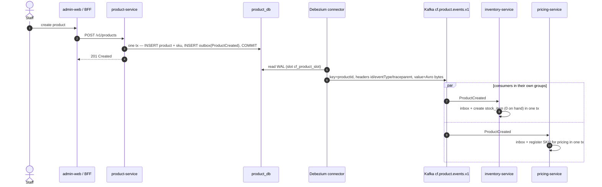
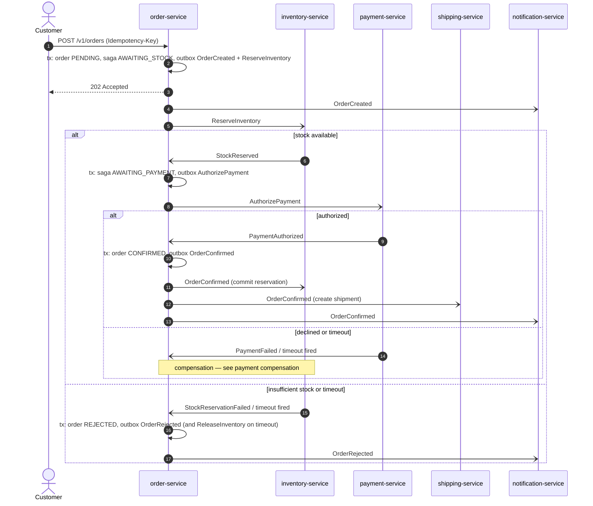
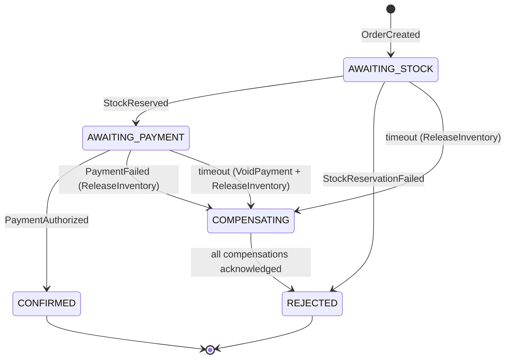
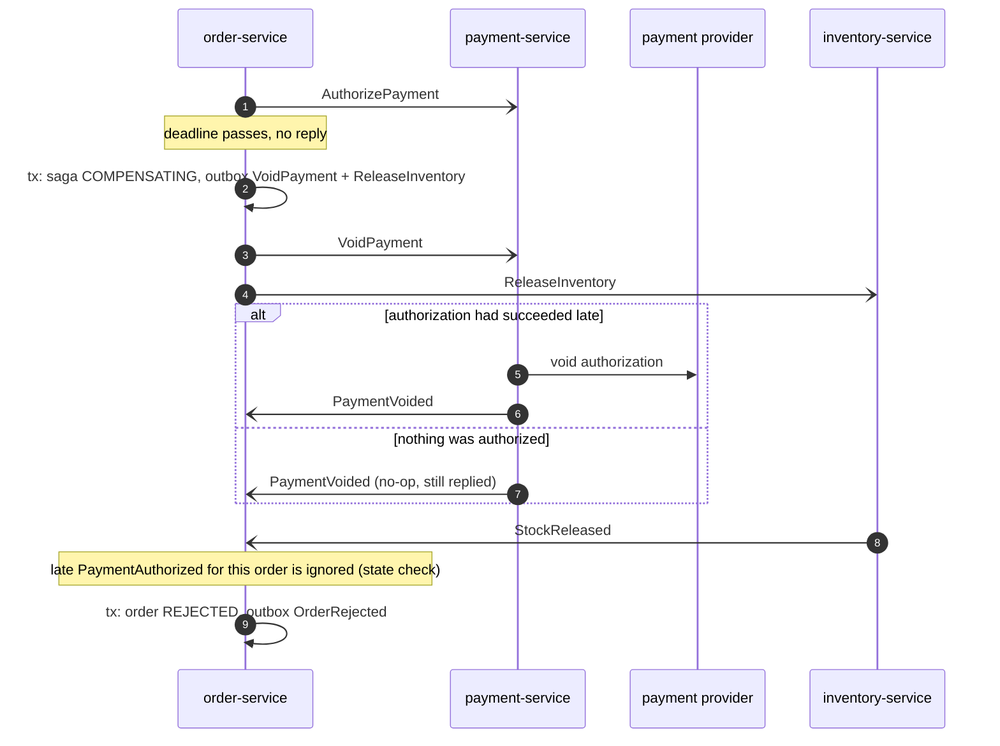

# Communication patterns

Status: **planned**. Patterns are decided (ADR-0006–0010); no messages flow yet.

## Choosing a pattern

| Need | Pattern | Example |
|---|---|---|
| Tell others a fact happened | Event via outbox → Debezium → Kafka | `ProductCreated` |
| Ask one service to do something as part of a coordinated process | Saga command via outbox, reply event | `ReserveInventory` → `StockReserved` |
| Read fresh data owned by another service, synchronously | HTTP API (OpenAPI), with timeout and fallback | price quote at checkout |
| UI reads and writes | HTTP through gateway (and admin BFF) | storefront order history |

Synchronous chains are limited to depth one (caller → owner). Events never require the
consumer to call back the producer to understand them.

## Product creation CDC flow

## Order saga

State machine (order-service):

## Payment compensation

Cancellation of a **confirmed** order is not a compensation: order-service emits
`OrderCancelled`; payment-service refunds (`PaymentRefunded`), inventory releases or
restocks, shipping stops the shipment if not yet dispatched.

## Synchronous calls (justified list)

| Caller | Callee | Call | Why synchronous | Failure behaviour |
|---|---|---|---|---|
| order-service | pricing-service | price quote for order lines | The customer must see and accept the final price before the order is created | Order creation fails with 503; nothing persisted |
| order-service | customer-service | validate customer and default address | Needed to create a valid order | 503; or use address supplied in request |
| admin BFF | any service API | composed reads | UI composition | Partial view with per-section errors |

Timeout and retry values are not defined yet; they are set per call from measurements.

## Related

[../event-catalog/event-driven-architecture.md](../event-catalog/event-driven-architecture.md) ·
ADR-0009 · `saga-pattern` skill
