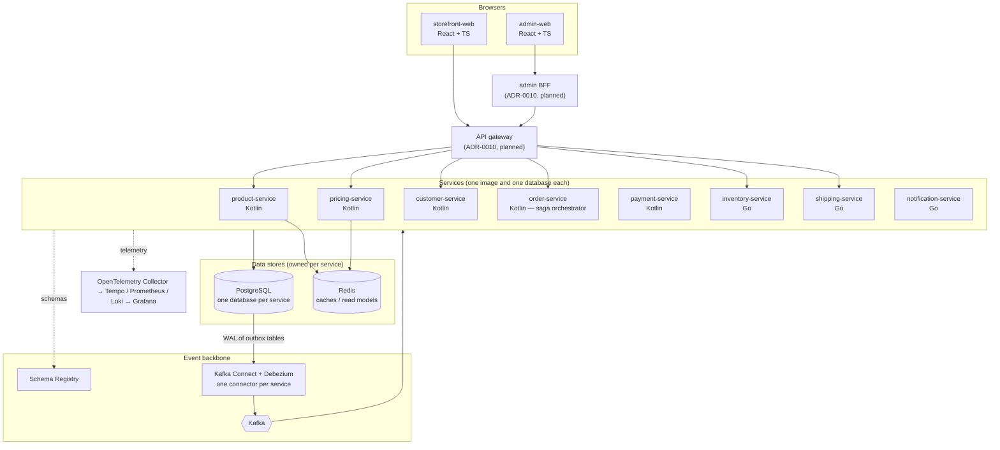

# Container architecture

Status: **planned**. Containers below are designed; none is built yet. The repository
folders for services and apps exist as documentation-only scaffolds.

## Diagram

## Containers

| Container | Technology | Responsibility | Data | Status |
|---|---|---|---|---|
| storefront-web | React, TypeScript, Vite | Customer UI | none (browser memory) | Planned (scaffold folder) |
| admin-web | React, TypeScript, Vite | Staff UI | none | Planned (scaffold folder) |
| API gateway | Open (product choice) | Edge routing, TLS, rate limits, CORS | none | Planned (ADR-0010) |
| admin BFF | Open | Token handler, read composition via service APIs | session store only | Planned (ADR-0010) |
| product-service | Kotlin, Spring Boot | Catalog | `product_db`, Redis cache | Planned |
| pricing-service | Kotlin, Spring Boot | Prices, promotions, quotes | `pricing_db`, Redis cache | Planned |
| customer-service | Kotlin, Spring Boot | Customer profiles | `customer_db` | Planned |
| order-service | Kotlin, Spring Boot | Orders, saga orchestration, order history | `order_db` | Planned |
| payment-service | Kotlin, Spring Boot | Payments via provider adapter | `payment_db` | Planned |
| inventory-service | Go | Stock, reservations | `inventory_db` | Planned |
| shipping-service | Go | Shipments, carriers | `shipping_db` | Planned |
| notification-service | Go | Notification delivery | `notification_db` | Planned |
| PostgreSQL | PostgreSQL 16 | One database per service | — | Planned |
| Redis | Redis | Caches and read models | per-service key prefixes | Planned |
| Kafka + Schema Registry | Kafka (KRaft) | Event backbone | topics | Planned |
| Kafka Connect + Debezium | Debezium PostgreSQL connector | Outbox → Kafka | Connect offsets | Planned |
| Observability stack | OTel Collector, Prometheus, Grafana, Loki, Tempo | Telemetry | time series, traces, logs | Planned |

Ports for local development: [service-catalog.md](service-catalog.md).

## Interaction rules

- Browser → gateway → service over HTTPS; services expose only the APIs in
  `contracts/openapi/`.
- Service → service: events through Kafka by default; synchronous HTTP only where
  justified ([communication-patterns.md](communication-patterns.md)).
- Services never connect to another service's database (ADR-0005).
- Only Kafka Connect reads outbox tables (CDC role per service).

## Trade-offs

| Choice | Benefit | Cost |
|---|---|---|
| Eight services instead of a modular monolith | Independent scaling and deployment per context | Operational overhead, eventual consistency |
| CDC relay instead of in-service publishers | One relay mechanism for two languages | Kafka Connect becomes critical infrastructure |
| Gateway + admin BFF | One edge, tokens off the admin browser | Two more deployables |
