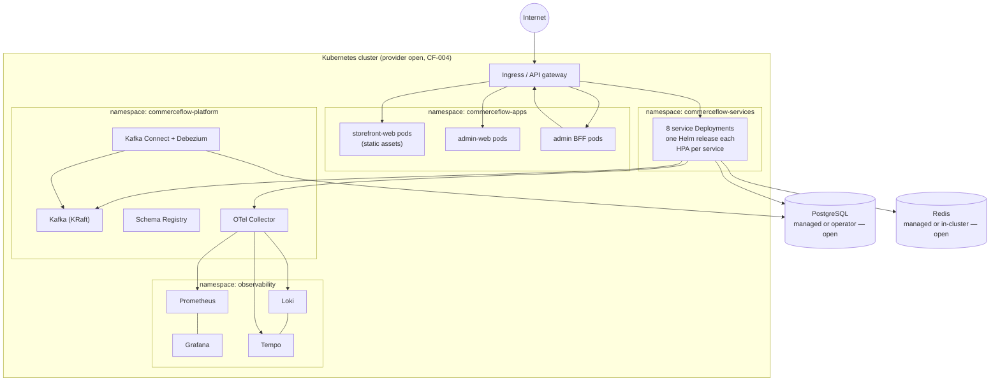

# Deployment architecture

Status: **planned**. Only a placeholder `docker-compose.yml` exists (no services). Cloud
provider, cluster topology and environments beyond local are **open** (CF-004).

## Environments

| Environment | Runtime | Purpose | Status |
|---|---|---|---|
| local | Docker Compose (root `docker-compose.yml`) | Development, integration and E2E tests | Planned (CF-005); file is a placeholder |
| CI | GitHub Actions runners + Testcontainers | Per-service build and tests | Planned (CF-020); no remote yet |
| staging | Kubernetes | Pre-production verification with mixed versions | Planned; provider open |
| production | Kubernetes | Customer traffic | Planned; provider open |

## Kubernetes target

## Per-service deployment unit

| Item | Rule |
|---|---|
| Image | One per service/app, built from its folder plus `contracts/`, tagged with the git SHA |
| Release | One Helm release per service using the shared chart template and its own values file |
| Configuration | Environment variables; secrets from Kubernetes Secrets or a secrets manager (open) |
| Probes | Readiness and liveness endpoints per service (`docker-kubernetes` skill) |
| Scaling | Horizontal Pod Autoscaler per service; consumer scaling limited by partition count |
| Network | NetworkPolicies: each service reaches its own database, Kafka, Schema Registry, the collector and explicitly allowed APIs |
| Migrations | Kotlin: Flyway at startup (locked) or a Job; Go: migration Job before rollout |

Resource requests, replica counts and autoscaling thresholds are **not defined yet**; they
will come from measurements (`performance-testing`), not estimates.

## Platform components

| Component | Options under consideration | Decision |
|---|---|---|
| PostgreSQL | Managed service per environment, or an operator in-cluster | Open (CF-004) |
| Kafka | Managed Kafka, or an operator (e.g. Strimzi) | Open (CF-004) |
| Redis | Managed, or in-cluster | Open |
| Secrets | Cloud secrets manager with external-secrets, or sealed secrets | Open |
| Terraform | Cloud resources (network, cluster, databases); location in repo decided with CF-004 | Open |

## Trade-offs

- **Kubernetes** gives one deployment model for eight services and the platform
  components, at the cost of cluster operations. A simpler PaaS was not chosen because the
  platform components (Kafka Connect, Debezium) need fine-grained control.
- **Managed data services** reduce operational risk for PostgreSQL and Kafka; they must
  support logical replication and replication-slot management for Debezium.

## Related

[build-and-release-strategy.md](build-and-release-strategy.md) · ADR-0011 ·
[disaster-recovery.md](disaster-recovery.md)
