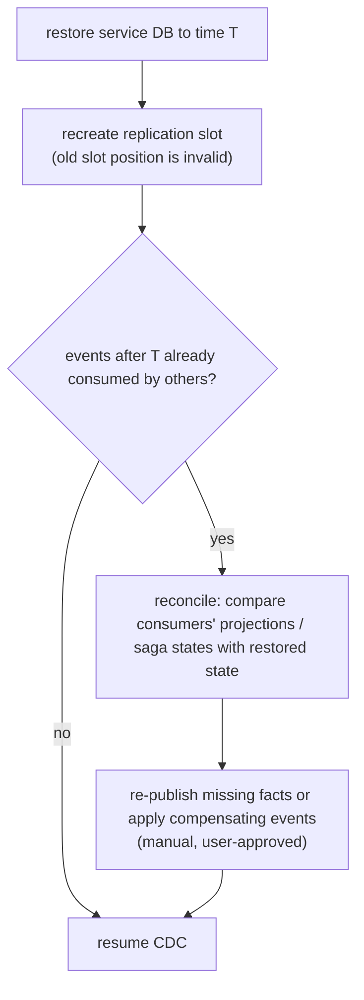

# Disaster recovery

Status: **planned**. No environment, backup or recovery procedure exists. **RPO and RTO
targets are not defined** — they must be agreed from business requirements (CF-027)
before backup frequency and topology can be chosen. This document describes mechanisms and
the recovery order that apply whatever the targets are.

## What must be recoverable

| Asset | Source of truth | Recovery mechanism (planned) |
|---|---|---|
| Service databases (8) | PostgreSQL | point-in-time recovery from base backups + WAL archive, per database/instance |
| Event streams | Kafka (retained for a window) | broker replication; outbox rows can be re-published for gaps within outbox retention |
| Schemas | Schema Registry (`_schemas` topic) | re-register from `contracts/events` in git |
| Kafka Connect state | connector configs (git) + offsets (Kafka) | re-apply configs from `infrastructure/debezium/`; offsets from the Connect offsets topic |
| Configuration and infrastructure | git (Helm values, Terraform) | redeploy from git |
| Images | container registry | rebuild from git SHA if the registry is lost |
| Observability data | Prometheus, Loki, Tempo | not business-critical; accept loss |

## Consistency after restoring one service's database

Restoring a database to a point in time breaks agreement with other services that already
consumed its later events. Recovery therefore includes reconciliation:

Consumers are idempotent (inbox), so re-published events with the original `eventId` are
safe; events that were lost and recreated get new IDs and must be checked by humans.

## Recovery order (full environment)

1. Infrastructure (cluster, network) from Terraform/Helm.
2. PostgreSQL instances and databases from backups.
3. Kafka, then Schema Registry (re-register schemas from git if needed).
4. Kafka Connect and connectors (new slots).
5. Services, in any order (they tolerate missing peers; sagas time out and compensate).
6. Gateway and BFF, then frontends.
7. Reconciliation of in-flight sagas (orders in non-terminal states).

## Practices (planned)

- Backups encrypted and stored in a separate location/account.
- Restore tests on a schedule (frequency to be set with RPO/RTO).
- Runbooks per scenario in `docs/runbooks/` (CF-023): database restore, slot loss, Kafka
  cluster loss, DLT backlog.
- Destructive recovery steps (dropping slots, deleting topics, resetting offsets) are
  manual and user-approved; Claude never runs them (guard hook).

## Open decisions

RPO/RTO (CF-027), managed vs self-operated data services (CF-004), multi-zone or
multi-region deployment, backup retention vs. data-erasure obligations
([data-retention-policy.md](data-retention-policy.md)).
