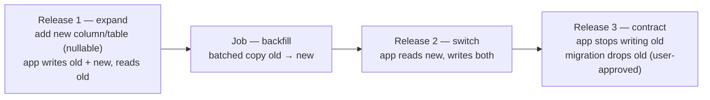

# Migration strategy

Status: **planned**. No migrations exist. Tools: Flyway (Kotlin services), golang-migrate
(Go services). Review workflow: `/database-migration-review`.

## Principles

1. **Every service migrates its own database, at its own time.** No migration touches
   another service's database.
2. **Backward compatible with the running version.** During a rolling deploy, version N
   and N+1 run against the same schema.
3. **Roll forward.** Production fixes are new migrations. Go `.down.sql` files exist for
   local development only. Applied migrations are never edited.
4. **Separate DDL from bulk data changes.** Backfills run in batches as jobs.
5. **Fail fast instead of blocking traffic:** every migration sets `lock_timeout` and
   `statement_timeout`.
6. **No destructive migration runs automatically.** `flyway clean/repair/undo` and
   `migrate down/drop/force` are denied by the guard hook.

## Expand / contract

The contract step requires the previous release to be fully rolled out everywhere and an
explicit approval, because it is the only step that loses data.

## Safe and unsafe operations

| Operation | Safe form |
|---|---|
| Add column | nullable, or with a constant default |
| Add NOT NULL | CHECK `NOT VALID` → `VALIDATE` → `SET NOT NULL` → drop CHECK |
| Add constraint | `NOT VALID`, then `VALIDATE CONSTRAINT` in a later migration |
| Add index on existing table | `CREATE INDEX CONCURRENTLY` in its own non-transactional migration |
| Rename / drop column | expand/contract over three releases |
| Change column type | new column + backfill + switch + drop |
| Large data update | batched job, not a migration |

Details and examples: `database-migrations` skill.

## Execution

| Language | How migrations run | Who |
|---|---|---|
| Kotlin | Flyway at application startup (Flyway takes a lock, so one replica applies) **or** a Kubernetes Job before rollout — choose per service; Job preferred when migrations may take long | migrator role |
| Go | golang-migrate as a Kubernetes Job / init container before rollout | migrator role |
| Local | same mechanisms against the Compose PostgreSQL | migrator role |

## Verification before release

- Apply all migrations from empty (Testcontainers).
- Apply on top of the previous version with seeded data; run repository tests.
- For expand steps, run the previous application version's repository tests against the
  new schema.
- Review with `/database-migration-review` (lock classification per statement).

## Outbox, inbox and CDC interplay

- The outbox table is created in each publishing service's first migration.
- Grants for the CDC role and the publication on `outbox` are applied after that migration
  (post-migration script owned by `database-engineer`).
- Changing the outbox schema affects the Debezium connector: treat it as a cross-service
  platform change planned with the architect.
