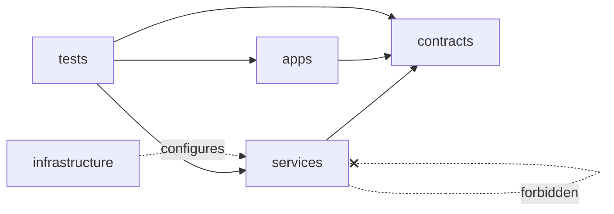

# Monorepo structure

Status: **implemented** for the folder layout, documentation and Claude Code
configuration; **planned** for everything inside service and app folders (no code yet).
Decision: ADR-0004.

## Layout

```text
commerceflow/                       (this repository; one Git history)
├── .claude/                        Claude Code: agents, skills, hooks, settings      Implemented
├── services/<name>-service/        one bounded context each (8)                      Scaffold (README, CLAUDE.md)
├── apps/{admin,storefront}-web/    frontends                                         Scaffold
├── contracts/
│   ├── events/                     Avro schemas (published language)                 Rules only, no schemas
│   ├── openapi/                    one OpenAPI document per service API              Empty
│   └── schemas/                    shared value shapes (Money, Address)              Empty
├── infrastructure/{docker,postgres,kafka,debezium,redis,monitoring,kubernetes}/      READMEs only
├── tests/{integration,contract,e2e,performance,resilience}/                          READMEs only
├── docs/{architecture,adr,event-catalog,runbooks}/ + catalogs                        Implemented (this documentation)
├── backlog/BACKLOG.md                                                                Implemented
├── scripts/affected-components.ps1                                                   Implemented
└── docker-compose.yml                                                                Placeholder (no services)
```

## What makes it a monorepo, not a monolith

| Rule | How it is kept |
|---|---|
| No root build | No root `settings.gradle.kts`, `go.mod`, `go.work` or workspace `package.json`. Each service/app builds from its folder. |
| No shared runtime code | Only `contracts/` is shared; services generate their own code from it. |
| No cross-service imports | Stop hook rule A7 (`check-architecture-docs.ps1`) and planned ArchUnit/Go import tests (CF-022). |
| No shared data | ADR-0005; roles per database. |
| Independent pipelines | One path-filtered workflow per component (ADR-0011, CF-020). |

## Ownership

Folder ownership by agent role is in `docs/agent-catalog.md`. Human code ownership
(CODEOWNERS) is planned once the repository has a remote and teams are known.

## Dependency direction between top-level folders



The crossed self-edge means: no dependency is allowed between two service folders.

## Trade-offs

- **Pro:** one review for a contract change and its consumers; shared tooling,
  documentation and Claude configuration; atomic refactors of docs and conventions.
- **Con:** boundaries are enforced by rules and checks instead of repository walls; CI
  must use path filters to avoid building everything; repository size grows with all
  services.
