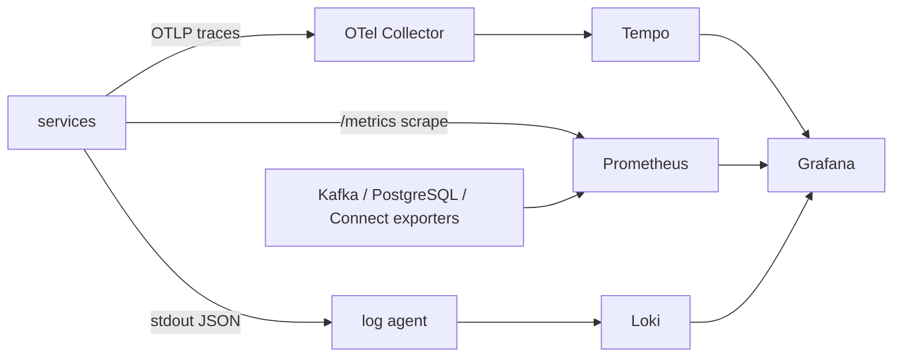

# Observability strategy

Status: **planned**. No telemetry pipeline exists (`infrastructure/monitoring/` holds only a
README; a collector template is in `.claude/skills/observability/reference/`). Skills:
`observability`, `distributed-tracing`.

## Signals

| Signal | Source | Store | Purpose |
|---|---|---|---|
| Traces | OpenTelemetry SDK/agent in every service, propagated over HTTP and Kafka | Tempo | where time is spent; one trace per customer action across async hops |
| Metrics | Micrometer (Kotlin), Prometheus client (Go), exporters (Kafka, PostgreSQL, Debezium) | Prometheus | detection, SLOs, capacity |
| Logs | JSON to stdout with `trace_id`/`span_id` | Loki | detail for a known trace or error |
| Dashboards and alerts | — | Grafana, Prometheus rules | humans |

## Asynchronous tracing

The `traceparent` of the producing span is stored in `outbox.trace_parent`, copied by
Debezium into the Kafka header, and extracted by consumers, so a placed order shows as one
trace through order, inventory and payment ([../event-catalog/outbox-design.md](../event-catalog/outbox-design.md)).

## What every service exposes

| Category | Metrics |
|---|---|
| RED per endpoint | rate, errors, duration histogram |
| Resources | DB pool usage, JVM heap/GC or Go goroutines, CPU, memory |
| Messaging | consumer lag, processing duration, retries, DLT sends, inbox duplicates |
| CDC (platform) | replication slot lag, connector state, outbox oldest row age |
| Business | orders created/confirmed/rejected, saga duration, sagas past deadline |

Labels stay low-cardinality (no order or customer IDs on metrics).

## Alerting

Alert **conditions** are planned (any DLT record on saga or money topics; sagas past
deadline; connector not running; slot lag growing; consumer lag growing). **Thresholds and
SLO targets are not defined**; they will be set from measurements and agreed SLOs (CF-025).
Every alert links a runbook in `docs/runbooks/` (CF-023).

## Privacy

No personal data, tokens or secrets in logs, span attributes or metric labels. Span names
and attributes follow OpenTelemetry semantic conventions; CommerceFlow-specific attributes
use the `commerceflow.` prefix.

## Trade-offs

Self-hosted Grafana stack keeps local and cluster setups identical and avoids vendor lock-in
before CF-004; a managed backend can replace Tempo/Loki/Prometheus later because services
only speak OTLP and Prometheus formats.
