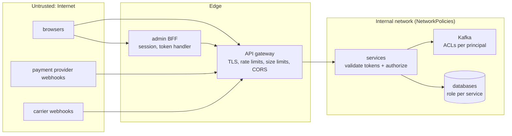

# Security architecture

Status: **planned** for application security. **Implemented today:** repository-side
controls only — Claude Code hooks that block secret writes/commits and destructive
commands, and permission deny rules (`docs/hook-catalog.md`). Workflow: `/security-audit`.

## Trust boundaries

## Controls by layer

| Layer | Control | Status |
|---|---|---|
| Edge | TLS, rate limiting, request size limits, CORS allow-list, webhook signature verification | Planned (ADR-0010) |
| Identity | OIDC; short-lived tokens; admin tokens never in the browser | Planned ([authentication-authorization.md](authentication-authorization.md)) |
| Service | JWT validation (issuer, audience, algorithm), function- and object-level authorization, input validation, problem details without internals | Planned |
| Data | database per service, least-privilege roles, `CONNECT` revoked from `PUBLIC`, encryption at rest (platform) | Planned |
| Messaging | Kafka authentication and ACLs; only Kafka Connect writes event/command topics | Planned |
| Secrets | environment variables from Kubernetes Secrets / secrets manager (open); `.env.example` only in git | Planned; secret detection hook implemented |
| Supply chain | pinned dependencies and base images, `govulncheck`, `npm audit`, Gradle dependency check, image scanning (Trivy), secret scanning in CI (gitleaks) | Planned |
| Runtime | non-root containers, read-only root filesystem, dropped capabilities, NetworkPolicies | Planned |
| Development | Claude Code hooks and permission denies | **Implemented** |

## Threat model highlights (STRIDE)

| Threat | Example | Mitigation |
|---|---|---|
| Spoofing | forged token, trusting gateway headers | JWT validation in every service |
| Tampering | client-supplied price | prices only from pricing-service quotes |
| Repudiation | untraceable admin price change | audit fields (who/when) and logs with trace ids |
| Information disclosure | another customer's order (IDOR); PII in events/logs | object checks, 404, data minimisation |
| Denial of service | unbounded pagination, checkout floods | limits, gateway rate limiting |
| Elevation of privilege | customer calling admin operations | role checks per operation, separate admin path via BFF |

## Payment data

No card data is processed or stored by CommerceFlow services; the payment provider's
hosted fields or redirect flow is assumed (CF-016). This keeps card-data compliance scope
with the provider; confirm when the provider is chosen.

## Reviews

Security-relevant changes (authentication, authorization, secrets, public endpoints,
payment, personal data, infrastructure exposure) require `/security-audit` by the
`security-reviewer` agent before merge.
