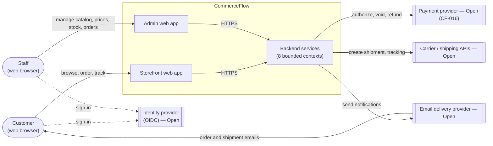

# System context

Status: **planned** — describes the target system. Nothing in this diagram runs today.
Legend used across `docs/`: **Implemented** = exists in this repository and was verified;
**Planned** = designed, not built; **Open** = decision not yet made.

## Purpose of the system

CommerceFlow lets customers browse a catalog, place orders and receive them, and lets
staff manage products, prices, stock, orders and shipments.

## Context diagram

## Actors

| Actor | Needs | Interface |
|---|---|---|
| Customer | Browse products, see prices and availability, order, pay, track, get notified | `apps/storefront-web`, email |
| Staff | Manage catalog, prices, promotions, stock, orders, shipments; support customers | `apps/admin-web` |

## External systems

| System | Used by | Purpose | Status |
|---|---|---|---|
| Identity provider (OIDC) | both apps, all services | Sign-in, access tokens, roles | Open — local development planned with Keycloak in Compose |
| Payment provider | payment-service | Authorize, capture, void, refund | Open (CF-016) |
| Carrier APIs | shipping-service | Create shipments, tracking updates | Open |
| Email provider | notification-service | Deliver transactional email | Open |

Each external system is reached through an anti-corruption adapter inside the owning
service (`domain-driven-design`), so a provider change affects one service.

## Scope boundaries

In scope: catalog, pricing and promotions, inventory, ordering, payments, fulfilment,
notifications, customer profiles. Not in scope (not planned): marketplace sellers, returns
management, analytics/BI platform, search engine beyond the catalog read model.

## Related

- Containers: [container-architecture.md](container-architecture.md)
- Contexts: [bounded-context-map.md](bounded-context-map.md)
- Security boundaries: [security-architecture.md](security-architecture.md)
