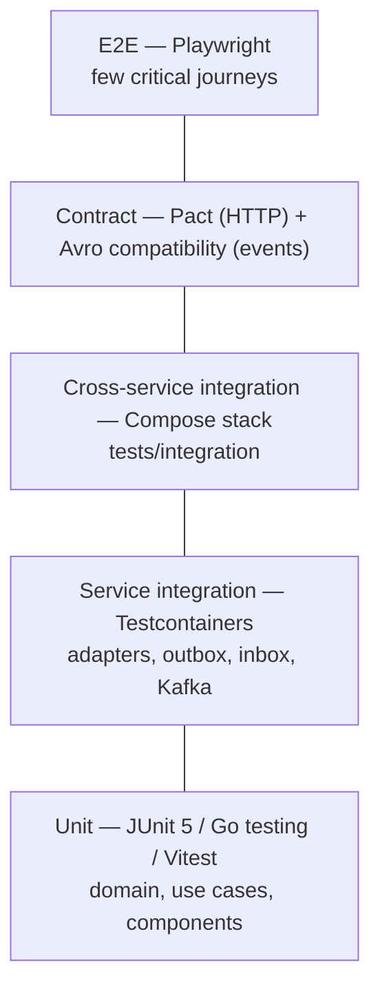

# Testing strategy

Status: **planned** for application tests (no code exists). **Implemented:** the hook test
suite `.claude/hooks/tests/Test-Hooks.ps1` (tests the Claude Code hooks only). Workflows:
`/write-tests`, `/run-e2e`.

## Pyramid

Non-functional layers run beside the pyramid: **performance** (k6, `tests/performance`) and
**resilience** (Toxiproxy, `tests/resilience`).

## Where tests live

| Layer | Location | Runs in |
|---|---|---|
| Unit, service integration | inside the service/app folder | that component's pipeline, from its folder |
| Consumer contract (Pact) | `apps/<app>/tests/pact`, calling services | consumer pipeline |
| Provider verification | inside the provider service | provider pipeline |
| Avro compatibility | `tests/contract` | contracts pipeline |
| Cross-service integration | `tests/integration` | nightly / pre-release against Compose |
| E2E | `apps/<app>/tests/e2e` (app-local), `tests/e2e` (cross-app) | app pipeline / nightly |
| Performance | `tests/performance` | on demand, pre-release |
| Resilience | service-local (single dependency) and `tests/resilience` | service pipeline / nightly |

## Mandatory cases

| Area | Required tests |
|---|---|
| Aggregates | every invariant: allowed and rejected case |
| Outbox | commit → row with correct topic/key/type; rollback → no row |
| Consumers | duplicate delivery → one effect; poison message → DLT; crash before ack → no double effect |
| Saga | each transition; each failure and timeout path; late replies |
| Migrations | from empty and from previous version |
| Security | 401 / 403 / 404-for-foreign-object on every protected endpoint |
| APIs | provider verification for every consumer pact |

## Tools

JUnit 5, AssertJ, MockK, ArchUnit (Kotlin) · Go `testing`, `-race`, testcontainers-go (Go) ·
Vitest, Testing Library, MSW (web) · Testcontainers · Pact · Playwright · k6 · Toxiproxy.

## Performance and SLOs

No performance targets are defined. Before load tests gate releases, SLOs must be agreed
in an ADR (CF-025) from business needs and baseline measurements. Example thresholds in
the `performance-testing` skill are placeholders.

## Reporting

Agents and workflows report only tests they ran, with real results. The test-reminder hook
asks Claude to run a component's tests after editing it.
