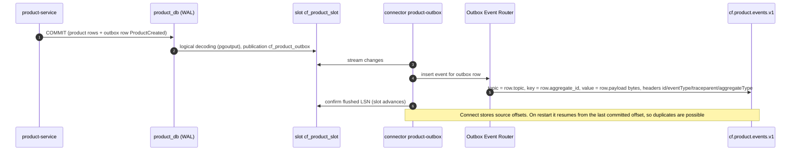

# Debezium design

Status: **planned**. No Kafka Connect, connector or replication setup exists. Decision:
ADR-0007. Implementation guidance and a connector template: `debezium-cdc` skill
(`.claude/skills/debezium-cdc/reference/outbox-connector.json`).

## Topology

| Item | Per service | Name |
|---|---|---|
| Connector | 1 | `<short>-outbox` |
| Publication | 1, on `outbox` only | `cf_<short>_outbox` |
| Replication slot | 1 | `cf_<short>_slot` |
| CDC role | 1 | `<short>_cdc` |
| Heartbeat table | 1 | `debezium_heartbeat` |

notification-service publishes no events and has no connector.

## Product creation CDC flow

## Key settings

| Setting | Value | Reason |
|---|---|---|
| `plugin.name` | `pgoutput` | built into PostgreSQL |
| `publication.autocreate.mode` | `disabled` | publication created by the database bootstrap, limited to `outbox` |
| `snapshot.mode` | `no_data` | the outbox needs no initial snapshot |
| `value.converter` | `ByteArrayConverter` | pass Avro bytes through unchanged |
| `transforms.outbox.route.by.field` | `topic` | per-row destination |
| `transforms.outbox.table.field.event.key` | `aggregate_id` | ordering per aggregate |
| `tombstones.on.delete` | `false` | cleanup deletes must not produce messages |
| `heartbeat.interval.ms` + action query | enabled | low-traffic databases still advance the slot |

PostgreSQL: `wal_level=logical`, enough `max_replication_slots`/`max_wal_senders`, and
`max_slot_wal_keep_size` as a disk safety cap. Concrete values are environment-specific
and not defined yet.

## Monitoring (planned)

- Connector and task state (`RUNNING`).
- Replication slot lag in bytes and `wal_status` per slot.
- Outbox oldest row age per service.

Alert thresholds are **not defined**; they will be set from observed behaviour
([../architecture/observability-strategy.md](../architecture/observability-strategy.md)).

## Failure scenarios

| Scenario | Effect | Recovery |
|---|---|---|
| Connector task fails | Events delayed; WAL retained by slot | Fix cause, restart task; duplicates expected |
| Kafka unavailable | Connector retries; WAL retained | Automatic once Kafka returns |
| Slot invalidated (`wal_status = lost`) after hitting `max_slot_wal_keep_size` | Connector cannot resume | Manual runbook: recreate slot; re-publish rows still in the outbox for the gap (needs outbox retention > outage) — user-approved |
| Database failover | Slot may not exist on the new primary (PostgreSQL < 17) | Recreate slot; replay from outbox; prefer failover slots where available |
| Outbox schema changed | Router errors | Treat outbox schema as a platform contract; change via planned cross-service change |
| Connector deleted, slot left | WAL grows | Drop unused slot — a manual, user-approved action (`pg_drop_replication_slot` is denied for Claude by the guard hook) |

## Trade-offs

CDC removes per-service relay code and keeps commit order, but adds Kafka Connect as a
critical dependency and makes database operations (failover, upgrades) CDC-aware.
