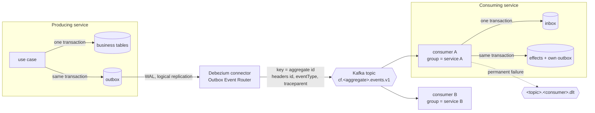

# Event-driven architecture

Status: **planned**. Decisions: ADR-0006 (outbox), ADR-0007 (Debezium), ADR-0008 (Kafka),
ADR-0009 (saga). Nothing is running yet.

## Why events

Services own their data (ADR-0005). Events let other contexts react to and keep copies of
facts without calling the owner synchronously, so a slow or unavailable service does not
block others, and new consumers can be added without changing the producer.

## End-to-end path

## Guarantees

| Property | Guarantee | Mechanism |
|---|---|---|
| No lost events | An event exists iff its business transaction committed | outbox in the same transaction |
| Delivery | at-least-once | Debezium offsets + consumer commit after DB transaction |
| Processing | effectively once per consumer | inbox keyed by `eventId` |
| Ordering | per Kafka key (aggregate) only | aggregate ID as key, single partition per key |
| Schema safety | consumers can read events from older producers | Avro + Schema Registry BACKWARD |
| Traceability | one trace across the async hop | `trace_parent` column → `traceparent` header |

Not guaranteed: global ordering across aggregates or topics; exactly-once delivery;
bounded end-to-end latency (no target defined; measured once running).

## Kinds of messages

| Kind | Naming | Producer → consumers | Example |
|---|---|---|---|
| Domain event (fact) | past tense | one producer → many consumers | `OrderConfirmed` |
| Saga command | imperative | order-service → one handler | `ReserveInventory` |
| Saga reply | past tense fact from the handler | handler → order-service | `StockReserved` |

Events are not used for queries or request/response with waiting callers.

## Event content rules

- Facts about the producer's own aggregate; IDs for anything owned elsewhere.
- Enough data for the known consumers to act without calling back.
- No personal data unless a consumer needs it to do its job (see data-retention-policy).
- Money as `Money`; time as UTC timestamp-millis.

## Consumers' responsibilities

1. Inbox-based deduplication in the same transaction as effects.
2. State checks for out-of-order or late messages (versions, saga states).
3. Bounded retries, then DLT; never block a partition forever.
4. Tolerant reading of optional fields.
5. Projections are rebuildable by replaying topics into a new consumer group.

## Trade-offs

| Benefit | Cost |
|---|---|
| Temporal decoupling, independent scaling, easy new consumers | Eventual consistency visible to users (e.g. availability updates later) |
| Single relay mechanism (CDC) for Kotlin and Go | Kafka Connect and replication slots to operate |
| Replay for new projections and recovery | Consumers must be idempotent; personal data in retained events must be limited |

## Documents

[event-catalog.md](event-catalog.md) · [event-naming-conventions.md](event-naming-conventions.md) ·
[event-versioning-policy.md](event-versioning-policy.md) · [outbox-design.md](outbox-design.md) ·
[debezium-design.md](debezium-design.md) · [kafka-topic-strategy.md](kafka-topic-strategy.md) ·
[retry-and-dlq-strategy.md](retry-and-dlq-strategy.md)
