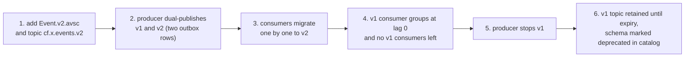

# Event versioning policy

Status: **planned**. Applies from the first registered schema. Workflow:
`/create-domain-event`; skill: `schema-evolution`.

## Compatibility mode

Every subject uses **BACKWARD**: a consumer built with the new schema can read events
written with the previous schema. Therefore, for additive changes, **consumers that need a
new field deploy first, producers last**.

## Change classes

| Change | Class | Procedure |
|---|---|---|
| Add an optional field with default | minor (same topic, new registry version) | Update schema + catalog; consumers that use it deploy first; producer starts filling it |
| Add an enum symbol (enum has a `default`) | minor | Same as above; consumers map unknown symbols to `UNKNOWN` |
| Remove a field that has a default | minor | Consumers stop reading it first; then remove |
| Add a required field / remove a required field | **major** | New `v<N+1>` |
| Rename a field, change a type, change semantics | **major** | New `v<N+1>` |
| Change the Kafka key or partitioning meaning | **major** | New topic `v<N+1>` |

## Major version procedure

Both versions carry the same `eventId` so a consumer reading both (during migration) can
deduplicate.

## Deprecation

- Mark the event or version as **deprecated** in `event-catalog.md` with the date and the
  replacement.
- A deprecated version is removed only when no consumer group reads it (checked via
  consumer group listing) — not on a fixed date.

## Governance

- Schema changes are reviewed by `event-driven-engineer` and `code-reviewer`.
- The catalogue (`README.md` summary and `event-catalog.md`) changes in the same commit as
  the schema; the Stop hook rule A1 checks this.
- Services never set `auto.register.schemas=true` in production; schemas are registered by
  the pipeline before the producer deploys.
- Contract shapes are separate from each service's domain model: services map in adapters.

## Status

| Item | State |
|---|---|
| Schema files | none yet (CF-002) |
| Schema Registry | not running (CF-005) |
| CI compatibility check | planned (`tests/contract`, `github-actions-cicd`) |
