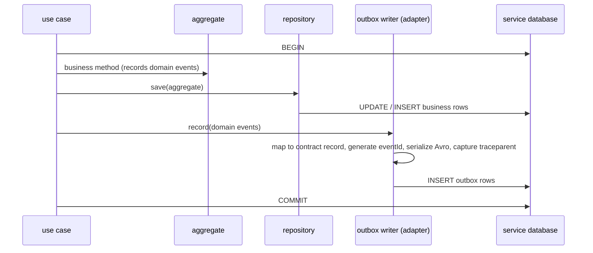

# Outbox design

Status: **planned**. No outbox table exists. Decision: ADR-0006. Implementation guidance:
`transactional-outbox` skill.

## Table (identical in every publishing service)

```sql
CREATE TABLE outbox (
  id             uuid        PRIMARY KEY,          -- eventId; Kafka header "id"; consumers' inbox key
  aggregate_type text        NOT NULL,             -- header "aggregateType"
  aggregate_id   text        NOT NULL,             -- Kafka key
  type           text        NOT NULL,             -- message name; header "eventType"
  topic          text        NOT NULL,             -- destination topic (router uses it)
  payload        bytea       NOT NULL,             -- Avro, Confluent wire format
  occurred_at    timestamptz NOT NULL DEFAULT now(),
  trace_parent   text                              -- W3C traceparent; header "traceparent"
);
CREATE INDEX outbox_occurred_at_idx ON outbox (occurred_at);
```

## Write path



## Rules

| Rule | Why |
|---|---|
| Outbox rows and business changes share one transaction | No dual write |
| Application code never calls a Kafka producer for events or commands | Single path to Kafka |
| One row per message; several rows per transaction allowed | Order kept per key by insertion order |
| `eventId` generated once by the mapper | Stable identity across retries and redelivery |
| Payload serialized with the registered schema (`auto.register.schemas=false`) | Bytes on Kafka match reviewed contracts |
| Rows are insert-only; cleanup deletes them later | Simple CDC semantics |
| Domain code does not see Avro classes | Contract ≠ domain model |

## Cleanup

Periodic batched delete of rows older than the retention window (proposed default 24 h,
[../architecture/data-retention-policy.md](../architecture/data-retention-policy.md)).
The window must exceed the longest CDC outage that is tolerated; outbox row age is
monitored so cleanup never deletes uncaptured rows.

## Open decision

Serializing Avro in the service requires a Schema Registry client at runtime (to obtain
schema IDs). Alternative: JSON payload converted by Debezium — rejected because the
resulting schemas would not be the reviewed contracts. If this changes, write an ADR.

## Trade-offs

- **Pro:** atomic, simple to reason about, works the same in Kotlin and Go.
- **Con:** extra writes per transaction; table bloat must be managed (cleanup,
  autovacuum); payload is binary in the database (debugging needs a decoder script).
