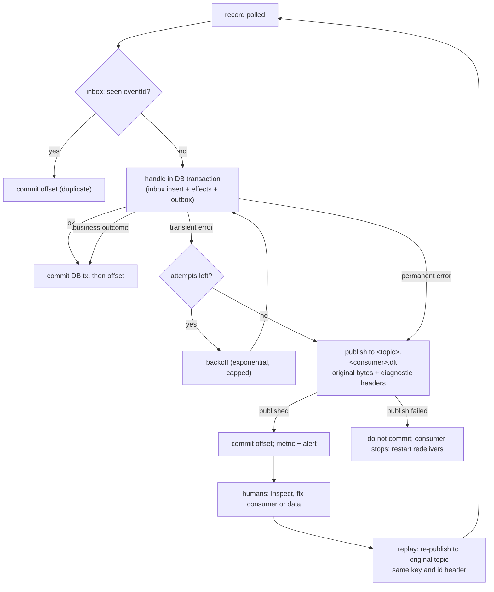

# Retry and DLQ strategy

Status: **planned**. No consumer exists. Guidance: `retry-and-dead-letter-queue` and
`idempotent-consumer` skills. Debugging: `/debug-event-flow`.

## Error classes

| Class | Examples | Handling |
|---|---|---|
| Business outcome | insufficient stock, payment declined | **Not an error**: emit the outcome event, commit, move on |
| Transient | database timeout, connection refused, serialization failure (`40001`), dependency 503 | Retry with exponential backoff, bounded attempts |
| Permanent | deserialization failure, missing `id` header, schema-invalid data, violated invariant that will never pass | Dead-letter immediately |

## Flow

## Blocking vs non-blocking retries

| Mode | Behaviour | Ordering | Used by |
|---|---|---|---|
| Blocking (default) | Retry in place; the partition waits | preserved per key | saga participants and orchestrator (inventory, payment, order), shipping |
| Non-blocking (retry topics) | Failed record moved to a retry topic; partition continues | **broken** per key | only order-independent consumers, e.g. notification-service |

Attempt counts and backoff intervals are configuration, **not defined yet**. Constraint:
total blocking retry time must stay below the consumer's `max.poll.interval.ms`.

## Dead-letter topics

- Name: `<source topic>.<consumer service>.dlt` (one per consumer, so ownership is clear).
- Content: original key, original value bytes, original headers, plus `dlt-original-topic`,
  `dlt-original-partition`, `dlt-original-offset`, `dlt-error`, `dlt-attempts`
  (Spring's `kafka_dlt-*` headers are equivalent).
- Every DLT record is an incident for the owning service; saga and money-related topics
  page.

## Replay

1. Fix the cause and deploy the consumer.
2. Inspect DLT records (read-only).
3. Re-publish each record to `dlt-original-topic` with the same key and `id` header.
4. The inbox makes accidental double replay harmless.

Replay is a manual, user-approved operation (planned tool `scripts/dlt-replay`, runbook
`docs/runbooks/dlt-replay.md`, CF-023). Claude does not replay automatically.

## Saga-specific rules

- Compensations (`ReleaseInventory`, `VoidPayment`, refunds) must eventually succeed:
  they retry, then DLT and page; they are never silently dropped.
- Late replies after a timeout are handled by state checks, not by the DLT.
